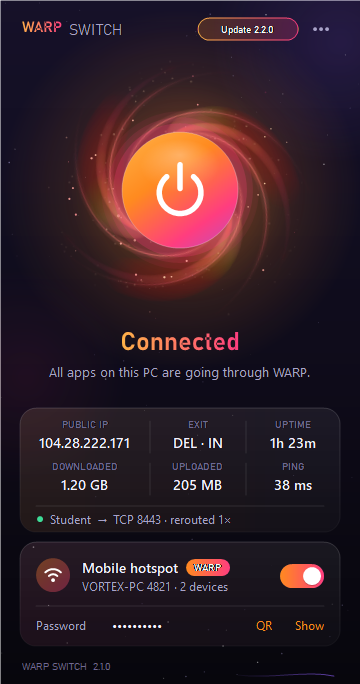
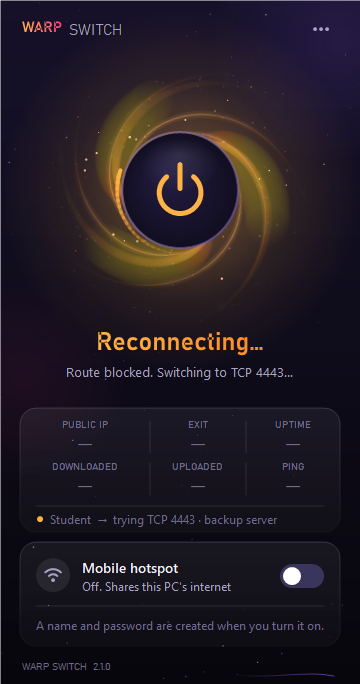
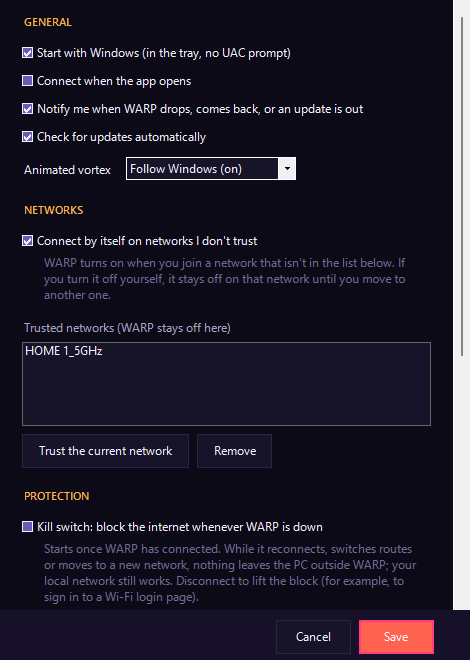

# WARP Switch

System-wide Cloudflare WARP for Windows that finds its way through restricted networks: campus Wi-Fi, office
networks, anywhere that blocks or keeps cutting VPN-like traffic. One button sends every app through WARP;
one switch shares that protected connection to your other devices over Mobile Hotspot.

<p align="center">
  
  &nbsp;
  
</p>

## What it does

- **Gets through.** Every connect scouts ten routes at once (server address × port × QUIC/TCP, disguised as
  normal HTTPS) and orders them by what actually answered. If the network blocks, cuts or starves a route, the
  tunnel moves to the next one by itself. It remembers what worked on each network.
- **Only says "Connected" when it's true.** A route counts as up after real traffic has come back through it.
- **System-wide.** All apps, IPv4 and IPv6, with DNS through Cloudflare, so poisoned answers from the network
  don't matter. Your local network (printers, login pages, intranet) keeps working directly.
- **Mobile Hotspot through WARP.** Phones and tablets that join your PC's hotspot go through WARP too. Scan a QR
  code to join instead of typing the password.
- **Kill switch** (optional): while WARP reconnects or switches routes, nothing leaves the PC outside it.
- **Split tunnel**: addresses, ranges or host names that should skip WARP.
- **Connects by itself** on networks you haven't marked as trusted (optional).
- **Encrypted DNS** outside the tunnel too, using Windows 11's own DNS over HTTPS (optional).
- **Survives real life**: sleep and wake, moving between networks, Wi-Fi dropping, Explorer restarting, crashes
  (anything it changed is put back at the next launch).
- **Updates itself** from this repository's releases.

<p align="center">
  
  &nbsp;
  
</p>

## Install

1. Download **`WarpSwitch-Setup-x.y.z.exe`** from the [latest release](https://github.com/DefectiveVortex/WarpSwitch/releases/latest).
2. Run it. Windows SmartScreen may say it "protected your PC" because the installer isn't code-signed with a
   paid certificate: choose **More info → Run anyway**. Each release lists the SHA-256 of every file in
   `SHA256SUMS.txt` if you want to check what you downloaded.
3. Open WARP Switch and click the orb. The first connect registers the PC with WARP (free, no account needed).

Needs Windows 10 or 11 (64-bit). Nothing else to install: .NET Framework 4.8 comes with Windows.

A single-file **portable** exe is attached to each release too. It does everything except *Start with Windows*,
which needs the installed copy (a sign-in task that runs a file you can write to with admin rights would let any
program on your account get admin rights).

### Updates

WARP Switch checks this repository's releases about twice a day (turn it off in Settings) and shows an
**Update** button when there's a new version. It downloads the installer, checks it against the release's
`SHA256SUMS.txt`, installs it silently, and reopens, reconnecting if WARP was on. You can also check by hand from
the **⋯** menu.

## Using it

- **Orb**: connect / disconnect (also Space or Enter). Click while it's starting to cancel.
- **Hotspot switch**: share the connection (also H). While WARP is on, devices that join use WARP.
- **⋯ menu**: Settings (Ctrl+,), the log, the app folder, updates.
- **Close button**: hides to the tray. Right-click the tray icon to quit.

Shortcuts and scripts can drive a running copy:

```
"C:\Program Files\WARP Switch\WarpSwitch.exe" --connect | --disconnect | --hotspot-on | --hotspot-off | --quit | --tray
```

### Kill switch

When it's on, WARP Switch adds two Windows Firewall rules once WARP has connected: everything leaving your Wi-Fi
or Ethernet adapter is blocked except WARP's own servers, your local network and your split-tunnel list. Traffic
inside the tunnel isn't affected. While the kill switch is on, WARP Switch keeps trying instead of giving up.
Disconnecting lifts the block (do that to sign in to a Wi-Fi login page). If the app is killed, the block stays
until you open it again; that's the point of a kill switch. Needs Windows Firewall to be on.

## Where things live

| What | Where |
| --- | --- |
| The app | `C:\Program Files\WARP Switch` |
| usque + wintun (checked against SHA-256 before every start), crash-recovery record, downloaded updates | `C:\ProgramData\WARP Switch` (admins only) |
| Your WARP registration, settings, learned routes, logs | `%LOCALAPPDATA%\WarpSwitch` |

Uninstalling removes the first two and asks about the third (keep it to reuse the same WARP registration).

## Privacy

No telemetry, no accounts, no servers of its own. WARP Switch talks to Cloudflare (WARP, and
`1.1.1.1/cdn-cgi/trace` to confirm traffic flows) and to github.com for update checks. Logs stay on your PC;
they contain network names and your public IP, so look before sharing one.

## Build from source

Needs the .NET SDK 8+ and, for the installer, [Inno Setup 6](https://jrsoftware.org/isinfo.php)
(`winget install JRSoftware.InnoSetup`).

```powershell
powershell -ExecutionPolicy Bypass -File build.ps1            # build, test, package into dist\
powershell -ExecutionPolicy Bypass -File build.ps1 -SkipInstaller
```

`build.ps1` downloads usque and wintun from their official releases, refuses anything whose SHA-256 doesn't match
the pinned value, packs them into the app, runs the tests, and writes the portable exe, the installer and
`SHA256SUMS.txt` to `dist\`.

`dotnet test tests\WarpSwitch.Tests` runs the tests on their own (after one `build.ps1` run). Set
`WARPSWITCH_RENDER_DIR` to a folder to also get PNGs of the windows in various states; that's where the
screenshots above come from.

### Releasing

1. Write the notes in `CHANGELOG.md`.
2. On GitHub, **Draft a new release** with a tag like `v2.2.0` and publish it.
3. The **Release** workflow builds that tag, runs the tests and attaches the installer, the portable exe and
   `SHA256SUMS.txt` (last, so the in-app updater only offers the release once everything is there).

Installed copies pick it up on their next check. The version number comes from the tag; the `<Version>` in
`WarpSwitch.csproj` only matters for local builds.

## How it works

WARP Switch drives [usque](https://github.com/Diniboy1123/usque), an open-source MASQUE client for WARP, in its
TUN mode, using WireGuard's [Wintun](https://www.wintun.net) driver for the adapter. Around it, the app does the
parts that make it work on hostile networks: route scouting and failover, routes and DNS through Windows' IP
Helper API, verifying traffic really flows, and putting everything back afterwards.

## Credits and license

Made by Vortex. MIT licensed, see [LICENSE](LICENSE). usque and Wintun keep their own licenses, see
[THIRD_PARTY_NOTICES.md](THIRD_PARTY_NOTICES.md).

WARP Switch isn't made by, affiliated with or endorsed by Cloudflare. "Cloudflare" and "WARP" are trademarks of
Cloudflare, Inc.
